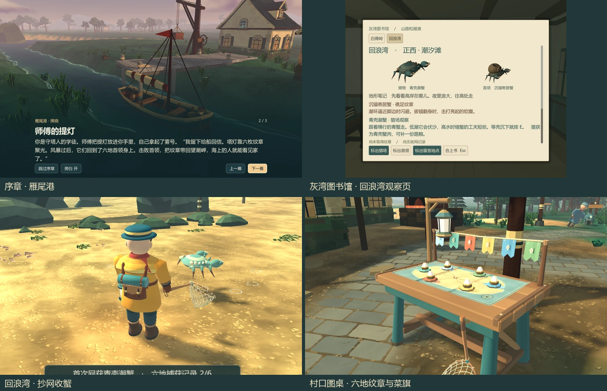
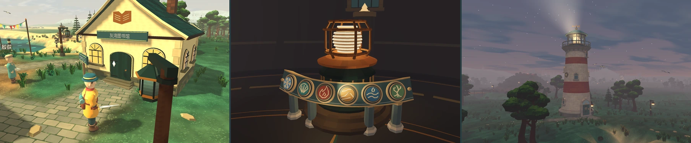
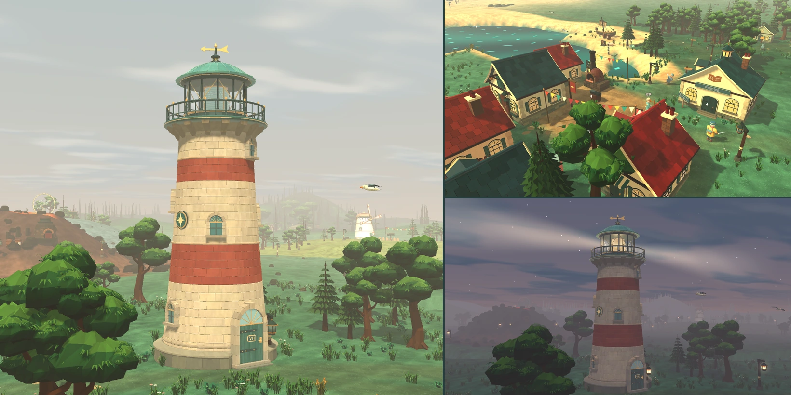
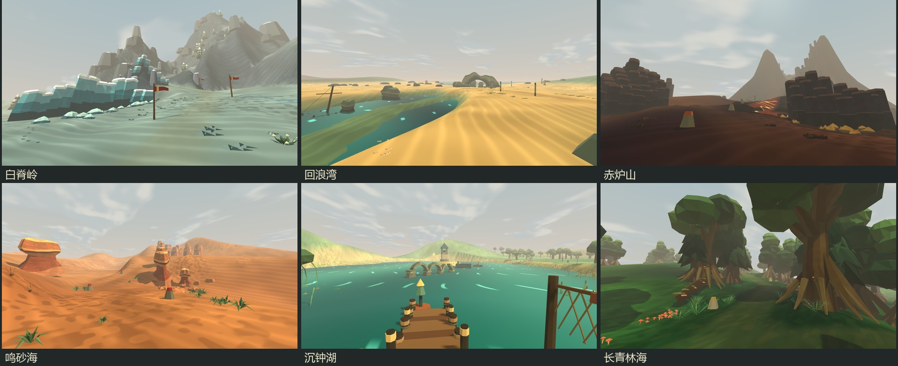

# 最后一座灯塔

**当前试玩版为 v0.7.0。** [启动 Windows 单文件版](build/greybay/最后一座灯塔-灰湾新路.exe)

风暴熄了望潮岬的灯，礁外还有船等着进港。你是守塔人的学徒，要从六地首领身上取回纹章，亲手把灯点亮。新游戏以三幕实景序章开场，带普通话旁白和字幕。可以自行翻页、关闭朗读，或按 Esc 跳过。已有旅程可以在标题页回看故事。

走进灰湾后，地图由你自己标记。图书馆的三面书架记着六地的路况，还画出了猎物和首领，注明何时下网、何时进攻。可以标出感兴趣的猎场、首领或村民留言，按 M 随时清除路线，也可以直接沿路出村。

在猎场靠近猎物，观察它收翅、伏沙或浮出水面的时刻，按 E 下网。首次捕获会记入图鉴。带猎获回村口图桌，可以选一道地方菜，备好路粮并获得限时的地区效果。例如，沙兔清汤能减轻在鸣砂海的饮水消耗。桌上的六面彩旗记着你做过哪些菜。



六座营地之间有一圈步道，你可以从任一区开始。每片区域的首领第一次倒下时，当地纹章会自动记入旅程，并在回访时提供护佑。集齐六枚后回到望潮岬，在塔门按 E 进镜室，走到灯芯旁再按一次 E 点灯。镜室里的六处纹章槽和海上的光束会依次亮起。



数字 1、2 切换近战和短弓。弓模式下按住左键瞄准，松开发射。R 吃饭，T 喝水。到营地按 E 补给并登记复归点，进入野外后按 Q 切换营地、猎场和首领目标。沉钟湖渡口可按 E 借船，W 划行，A / D 掌舵，在钟楼或渡口按 E 系舟。

灯塔、灰湾港建筑与船只、守塔人和岛民、主岛敌人及六区远征生物均采用 Blender 模型。六座野外营地各有自己的建筑和道具。可以打开 [Blender 源模型目录](art_source) 编辑模型。

灰湾图书馆的山墙上画着海浪与罗盘星。沿岸可以看到跟随潮位变化的浪沫，望潮岬的镜室里则装上了黄铜航海刻度盘和分格玻璃。[查看 v0.6.0 与 v0.6.1 同机位实景对比](docs/screenshots/greybay-art-v061.webp)





## 启动

运行试玩包时，双击 `build/greybay/最后一座灯塔-灰湾新路.exe`。从源码运行时，用 Godot 4.6.3 打开 [游戏工程](game/project.godot) 后按 F5。

| 操作 | 按键 |
| --- | --- |
| 相对镜头移动、奔跑 | WASD、按住 Shift |
| 转动视线和角色、攻击 | 移动鼠标、左键 |
| 挂灯或收灯、举灯驱暗 | F、按住右键 |
| 向移动方向闪避、交互 | 空格、E |
| 展开岛图、委托手记、暂停或返回 | M、J、Esc |

左键依次打出横切、回锋和破势。敌人蓄力时，地上的扇形标出攻击范围。等预警波纹抵达外沿再按空格闪开，随后点左键可打出回身反击。星尺台西南的守灯盘有两轮独立挑战。

## 五个试玩版本

| 版本 | 本版新增 | Windows 启动文件 |
| --- | --- | --- |
| V1 拓岛 | 六处新地标、九条新路、东汊桥与扩展岛图 | [运行 V1](build/iterations/V1/TheLastLighthouse.exe) |
| V2 交锋 | 三段连击、险避反击、蟹类正面防御与贴地攻击预警 | [运行 V2](build/iterations/V2/TheLastLighthouse.exe) |
| V3 邻里 | 四位可交谈的岛民、拓印、送信、采药与委托手记 | [运行 V3](build/iterations/V3/TheLastLighthouse.exe) |
| V4 海风 | 手绘风格标题插画、暖色天光、窗台花箱、风中旗串与海鸟 | [运行 V4](build/iterations/V4/TheLastLighthouse.exe) |
| V5 归帆 | 五座邮驿、潮钟谜题、每日归港、星尺台守灯及委托导航 | [运行 V5](build/windows/TheLastLighthouse.exe) |

V1 至 V4 在各自的 `TheLastLighthouse-Iteration1` 至 `TheLastLighthouse-Iteration4` 目录保存。V5 可从标题页继续原版存档。

## 从灰湾出发

| 地区 | 首领 | 首杀纹章 |
| --- | --- | --- |
| 白脊岭 | 雪鬃盘角羊 | 雪绒 |
| 回浪湾 | 沉锚寄居蟹 | 礁足 |
| 赤炉山 | 引雷角兽 | 余烬 |
| 鸣砂海 | 鸣砂巨蝎 | 背风 |
| 沉钟湖 | 回声鳐 | 听澜 |
| 长青林海 | 冠枝角鹿 | 盘根 |

村口的渔人被影兽围住时，可以举灯逼退它，也可以挥刀解围。采集树脂和废铁能在铁匠铺打造短矛、护肩。林间营火可以登记复归地点。沿途书信、猎场和村民委托都可以按自己的节奏探索。

码头另有修船支线。去月牙滩扳开沉船绞盘取缆绳，去镜湖泵站打开旁通阀取密封圈，或在赤炉冷却窑等蒸汽散去后取铸件。带其中任意一份回码头按 E，就能帮助渔人修船。港口引航灯随望潮岬主灯亮起。铁匠铺可以补满随身提灯，首次到林间营火也可取应急灯油。

每次取得纹章、打造装备和完成重要交互，游戏都会自动存档。Windows 版的当前记录是 `%APPDATA%/TheLastLighthouse/six-crests-v1.cfg`，旁边的 `.bak` 保留上一份快照。首次续玩也会查找旧版 `expedition-v1.cfg` 和 `island-v1.cfg` 及其备份。旧版已点灯的旅程可以继续探索。尚未通关且停在塔内、纹章未齐的角色会回到塔外，继续收集余下的纹章。新进度另存，旧版本的文件可以继续用于原版。

## 开发与验证

[六区远征设计文档与大陆地图](<docs/最后一座灯塔·六区远征 GDD.html>) 可离线打开。[原版设计总览](docs/GDD.md) 保留了早期系统设计。[当前灯塔主线](docs/features/lighthouse/design.md) 说明 v0.6.0 的点灯条件。专项回归位于 [tests](tests) 目录，覆盖主线、地图连通、战斗、岛民委托、守灯、潮钟和邮驿。

以下命令从仓库根目录运行。将 `godot` 指向本机 Godot 4.6.3 可执行文件。导出时需安装同版本的 Windows x86_64 release 模板。

```powershell
godot --headless --path game --import
godot --headless --path game --fixed-fps 60 --script ../tests/progression.gd
godot --headless --path game --fixed-fps 60 --script ../tests/continental_geography.gd
New-Item -ItemType Directory -Force build/greybay
godot --headless --path game --export-release "Windows Desktop" "../build/greybay/最后一座灯塔-灰湾新路.exe"
```

[主线回归测试](tests/progression.gd) 在独立临时存档中验证六区乱序首杀、纹章去重、塔门与地图指引、镜室点灯、旧档续玩，以及修船、锻造和复归。测试通过位置跳转缩短行走时间。完整路线与近战、弓箭的首领对决另有专项测试。
