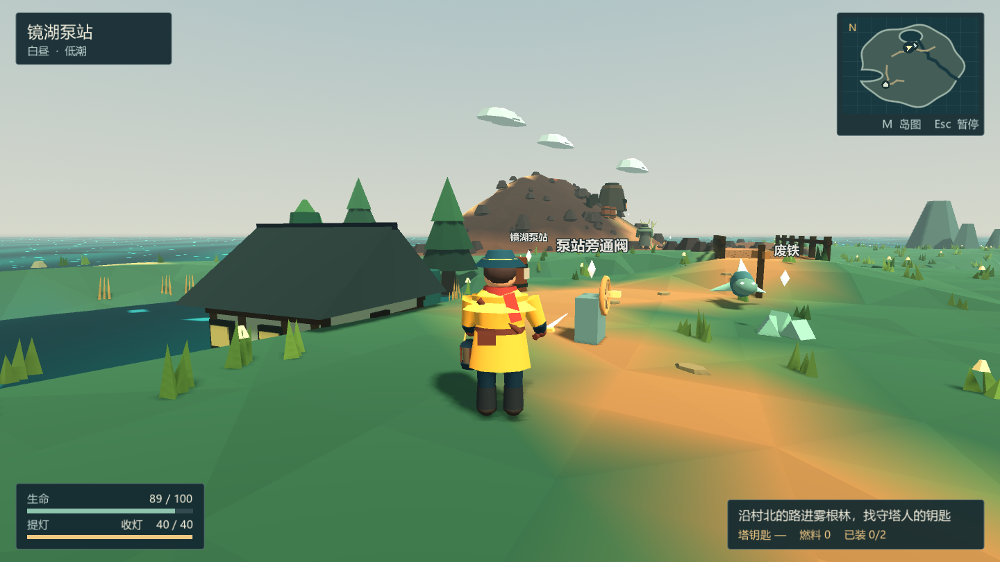

# 最后一座灯塔

一座停灯的孤岛，一个带着油灯出门的守塔人学徒。你可以沿高岸穿过雾根林，也可以等潮退后走礁脊。找到塔门钥匙和两罐燃料，回到望潮岬，借镜光破开守护者的影壳，亲手把灯点亮。

**v0.2 是 Windows 单人可玩原型。** 摄像机在角色身后高处，默认相距约 5 米。鼠标可以转身、抬头看地标，镜头遇墙会自动收近。三小时是完整游戏的目标，本版集中在一次可从头走到结尾的岛屿冒险。



## 启动

本地试玩包的入口是 `build/windows/TheLastLighthouse.exe`，可单独复制运行。源码使用 Godot 4.6.3。打开 [游戏工程](game/project.godot) 后按 F5 启动整个项目。

| 操作 | 按键 |
| --- | --- |
| 相对镜头移动、奔跑 | WASD、按住 Shift |
| 转动视线和角色、攻击 | 移动鼠标、左键 |
| 挂灯或收灯、举灯驱暗 | F、按住右键 |
| 向移动方向闪避、交互 | 空格、E |
| 展开岛图、暂停或返回 | M、Esc |

## 从灰湾出发

沿村北道路进林，从小屋取钥匙。三处油库任选两处，途中可以先取油再找钥匙。沉船用绞盘开舱，镜湖泵站先松旁通阀，冷却窑要等喷汽停歇。每个油罐都只出现一次。塔用燃料与提灯灯油分别记录。

村口的渔人正被影兽围住。用灯逼退它，或挥刀解围。采集树脂和废铁可在铁匠铺打造短矛、护肩，靠近工作台按 E 即可补油。林间营火可设置复归地点；白昼、夜色与潮水独立变化。已安装两罐燃料后，还可为码头的引航灯寻找第三罐。

到塔下先开门，再次交互装罐。补齐后登塔，拉镜柄唤醒守护者。镜架和提灯都可以打开攻击窗口。击败它后，走到灯芯按 E 点亮灯塔。

游戏会在拾取、打造、装罐和探索途中自动保存。退出后由标题页继续。Windows 存档位于 `%APPDATA%/TheLastLighthouse/island-v1.cfg`，同目录保留上一份快照。

## 开发与验证

[设计总览](docs/GDD.md) 记录了完整游戏的目标与各系统设计。v0.2 实装四种地形小怪、一种精英和一场两阶段守护者战，当前配方使用废铁与树脂。后续内容包括各地形专属精英、更多出行装备，以及面向三小时内容量的探索和遭遇。

以下命令从仓库根目录运行。将 `godot` 指向本机 Godot 4.6.3 可执行文件。导出时需安装同版本的 Windows x86_64 release 模板。

```powershell
godot --headless --path game --import
godot --headless --path game --fixed-fps 60 --script ../tests/progression.gd
New-Item -ItemType Directory -Force build/windows
godot --headless --path game --export-release "Windows Desktop" ../build/windows/TheLastLighthouse.exe
```

[主线回归测试](tests/progression.gd) 在独立的临时存档中验证三种油罐组合、分次装罐、锻造扣料、复归、空油镜架破壳、结局和读档。它用位置跳转缩短测试时间；走路、过桥和镜头遮挡另行在实景中验证。
