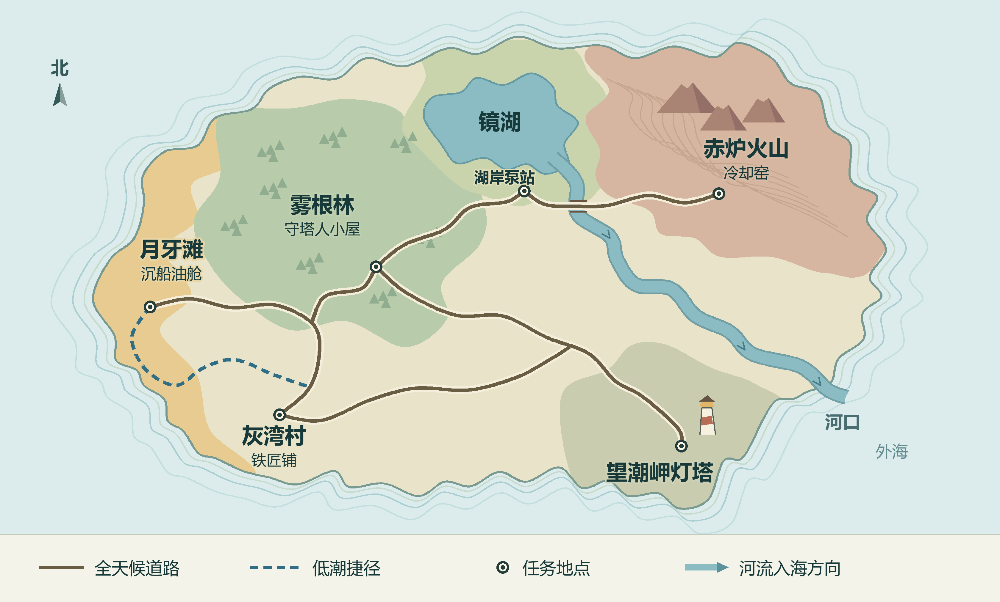

# 岛屿探索与燃料路线

**Status:** in progress · 2026-11-23 · [设计总览](../../GDD.md) · [原型实现](implementation.md) · [验证记录](testing.md)

[ASSUMPTION] 本篇的地点、取得方式、时间与数值均为首版设计提案，待原型试玩核对。

## 岛屿与水系

从灰湾村向北走，丛林尽头会露出镜湖。赤炉火山贴着湖的东岸，湖水从东南侧流出，沿河谷一路汇入大海。望潮岬灯塔立在河口西南方，进村的船都要经过它。

岛屿空间与路线示意。方位固定，路径表示连通关系，距离以灰盒实测为准。

### 玩家怎样认路

站在村北的高地，向西北看见折断的桅杆，朝东北看见树梢后的火山。站上观景点，玩家可转动镜头，从远山顺着林线找到断桅。进入林下后，用系在树干上的褪色布带引向守塔人小屋。湖岸转弯处第一次同时露出泵房水轮和山坡窑顶，玩家可就地换目的地。

村、树林和海滩之间保留涨潮也能走的高岸路。低潮才露出的礁脊把海滩接到村北林口。湖往海的水流始终可辨；潮水只影响沿海低地与河口下游的水位。

## 钥匙与三处燃料

开局就能走到塔门。锁面刻着守塔人惯用的树形记号，旁边的供油牌画出两只油罐。钥匙开外门，两罐塔用燃料启动塔内供油机；玩家可以先拿钥匙，也可以沿途先取燃料。

| 目标 | 玩家看见什么 | 取得方式 |
| --- | --- | --- |
| 雾根林小屋 | 沿树布走到窗框发亮的小屋。 | 影兽堵住前廊。举灯逼退它，或绕到屋后翻过倒木，从工具挂板取下黄铜钥匙。 |
| 月牙滩沉船 | 断桅旁的舱盖随潮水起伏。 | 低潮沿礁脊到船边；涨潮走高岸栈桥登上甲板。扳开绞盘，取出货舱的封装油罐。 |
| 镜湖泵站 | 水轮停着，一段拦污栅卡在轮下。 | 松开两端的卡销让轮子复转。水位标尺下降，维修台露出，可取备用油罐。 |
| 赤炉冷却窑 | 喷口处铁链被蒸汽吹得作响。 | 看排汽口由红转灰，分两段穿过冷却架，从运矿车上卸下油罐。坡顶小径通回湖岸。 |

三处各有一罐，两罐已足够。供油机装满后，码头才接收多出的第三罐来点引航灯，结尾多一排渔船循灯回港。钥匙和封装油罐收进任务栏，分别开锁和入机；提灯、铁匠铺都只取各自的消耗品。

### 首次游玩的时间预算

| 时段 | 典型经历 | 节奏落点 |
| --- | --- | --- |
| 0–15 分钟 | 在铁匠处领短刀与油，去村口驱散影兽、救回渔人。 | 第一次主动走出火光。 |
| 15–50 分钟 | 走一圈雾根林，取钥匙，发现湖边的第二条路。 | 辨认地标，打第一场短仗。 |
| 50–115 分钟 | 自选两处燃料点，沿途开路、采料，回村整备。 | 交替安排险段与安全归途。 |
| 115–145 分钟 | 自由探索一处支线，或挑战精英、打造装备、赶往塔下。 | 给探索与重试留出余量。 |
| 145–180 分钟 | 入塔、学会使用镜架、挑战守护者，再次点亮海面。 | 决战后留时间看村庄回应。 |

每个燃料点包含辨认入口、走过危险地段、操作设施和开通回程路四段。沉船可从舱内放下舷梯，泵站复转后会抬起维修桥，冷却窑的运矿车可撞开回湖的木栅。熟练玩家可以提早点灯。
